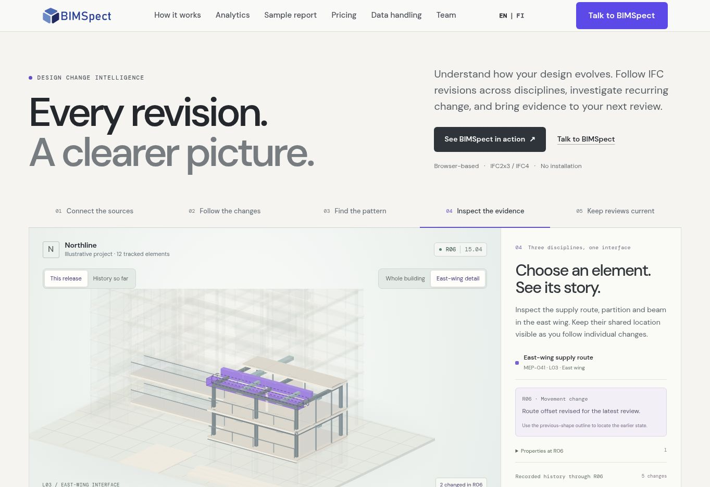

# Connected model history: implementation handoff

## Outcome

This iteration extends the English homepage from a guided model illustration
into a connected exploration of sources, revisions, element evidence and review
context. It builds on commit `42069c8aa6d0106f764af07d8a5db11066a87233`
on `feat/design-history-homepage`.

The story is: **several disciplines contribute to an evolving design; changes
accumulate through releases; element history explains the pattern; a review
captures evidence that can be revisited when its source elements change.**

The Northline fixture remains explicitly illustrative: six releases, twelve
tracked elements and eighteen recorded events. Additional building geometry
provides context and is not included in the event metrics. Existing geometry,
stable identifiers and event counts are preserved. Property values are synthetic.
The source lanes are aligned sample histories, not a demonstration of independent
asynchronous model ingestion.

## What visitors can now explore

| Interaction | Result |
| --- | --- |
| Source cards and ARC / STR / MEP history lanes | Identify the contributing source model and choose a release and discipline together |
| Discipline filters | Emphasize the corresponding building systems and scope the element/event counts |
| This release / History so far | Distinguish new events from elements that have changed in more than one release |
| Whole building / East-wing detail | Keep project context or enlarge the shared partition, beam and service-route interface |
| Element buttons and change lists | Select the route, partition, beam or another changed element and inspect its own history |
| Previous-shape control | Show an earlier outline for an exact-release movement or geometry event; information-only and baseline states have no ghost |
| Property evidence | Read before/after values for information events, with properties reconstructed at the selected release |
| Captured review and later changes | Preserve the original R04 evidence while showing subsequent events on referenced elements |
| Preview this history | Open an inline report using the current release, discipline and selected element; changing the report release updates the model too |

The five chapter labels are now Connect the sources, Follow the changes, Find
the pattern, Inspect the evidence and Keep reviews current. Chapter navigation
preserves the selected release and valid element selection. Selecting an element
outside the east-wing interface switches to the building view and corresponding
location copy. Choosing a discipline cannot leave an incompatible selected
element silently active.

## Review and report semantics

`SAMPLE-REVIEW-01` is an illustrative Open review created at R04. It references
`ARC-112`, `STR-028` and `MEP-041`. Its source evidence is fixed at eight events
through R04. Viewing later releases does not rewrite that evidence or change the
review status.

| Selected history | Review state | Later events | Referenced elements changed later |
| --- | --- | ---: | ---: |
| R01–R03 | Not yet recorded | 0 | 0 |
| R04 | Captured evidence available | 0 | 0 |
| R05 | Captured evidence plus later update | 1 | 1 |
| R06 | Captured evidence plus later updates | 3 | 2 |

The review explicitly retains its original ARC / STR / MEP scope even when
the model and metrics are filtered. **View R04 context** restores all three
disciplines and the interface view. A later event can be opened in the selected
element's evidence panel. These observations provide a reason to revisit the
review; they do not establish causation, a clash, approval or engineering risk.

The inline report shares the live selection. Its chart and counts stop at the
chosen release. If no element was selected, an automatically chosen example is
labeled **Example focus**. The separate sample-report section still presents a
fixed R06 example by default. Neither preview creates a file, sends a lead or
claims to be a customer report.

## Implementation map

| File | Responsibility |
| --- | --- |
| `components/design-story/story-data.ts` | Synthetic sources, property history, scoped summaries and fixed review evidence |
| `components/design-story/story-state.ts` | Shared selection reducer and cross-control consistency |
| `components/design-story/story-rendering.ts` | Shared discipline/context emphasis, selection colors and previous geometry rules |
| `components/design-story/StoryScene.tsx` | WebGL element selection, system emphasis and interface framing |
| `components/design-story/StoryFallback.tsx` | Matching SVG presentation of the same selection and evidence |
| `components/design-story/StoryEvidence.tsx` | Source, pattern, element and review evidence panels |
| `components/design-story/DesignStory.tsx` | Native HTML controls, keyboard/focus handling and connected report dock |
| `components/design-story/DesignReportPreview.tsx` | Release- and discipline-scoped illustrative report |
| `components/design-story/design-story.module.css` | Responsive controls, evidence presentation and focus/contrast styles |
| `test/design-story.test.ts` | Data, transform, property, scope and review invariants |
| `test/design-story-state.test.ts` | Selection, navigation and scope consistency |

The existing demand-rendered lifecycle, near-viewport loading and reduced-motion
handling remain in use. The SVG fallback retains native HTML controls and
evidence when WebGL is unavailable. Inspecting an event transfers keyboard focus
to the element heading when the old evidence control is removed. Closing a
report returns focus to its trigger, or the active chapter tab if the trigger
is no longer mounted.

## Verification: 20 October 2026

- Production `npm run build` passed, including TypeScript and generation of
  all seventeen static pages.
- Thirty-seven named tests passed across the two story files and the existing
  homepage flow, readability, hero-model and discipline-model checks.
- Scoped ESLint passed and `git diff --check` was clean.
- Production-mode Chromium preview was inspected at a 1363 px desktop viewport
  and 390 px / 768 px responsive iframe viewports. The checked layouts had no
  page-wide horizontal overflow. The mobile chapter strip scrolls intentionally.
- Browser checks covered source/release filtering, chapter release preservation,
  non-interface element selection, heading focus after keyboard inspection,
  R05 property evidence without a previous-shape control, R06 previous-shape
  availability, frozen review evidence, restoration of R04 shared context,
  connected report counts and close-focus fallback.
- The report showed three releases / ten events / two repeatedly changed
  elements through R03, and six / eighteen / three through R06.
- Source review confirmed that the four adjusted small-text colors meet 4.5:1
  on their declared default and selected surfaces. This was a focused check,
  not a complete accessibility certification.

The executor initially prevented Next's child TypeScript process from returning
captured output. The unchanged build and test commands passed when run with
normal subprocess support. No compiler gate or dependency was changed.

### Remaining checks

The available Chromium environment reported that WebGL was disabled and could
not create a context. Browser validation therefore covered the SVG fallback and
HTML controls. GPU appearance, mesh clicking, animation performance and physical
touch-device behavior still require checking on a WebGL-capable machine. The
responsive tests are iframe layout checks, not physical phone testing. No real
lead, CRM receipt or report delivery was submitted or tested.

No pricing, campaign/enquiry implementation, API route, Finnish copy, dependency
or deployment configuration is changed by this iteration. The separately
reported local F02 remediation is not present in this checkout. No deployment
was performed.

## Preview

The screenshot shows the illustrative SVG fallback with the east-wing route
selected. Its image is a browser observation, not a GPU-rendering validation.



## Pull into an existing checkout

Save any local work, including F02, in a commit before merging this branch:

```bash
git fetch origin feat/design-history-homepage
git merge FETCH_HEAD
```

Then use the repository's normal `npm run dev`, or `npm run build` followed by
`npm start`. Existing installation and Docker instructions remain in the README.
